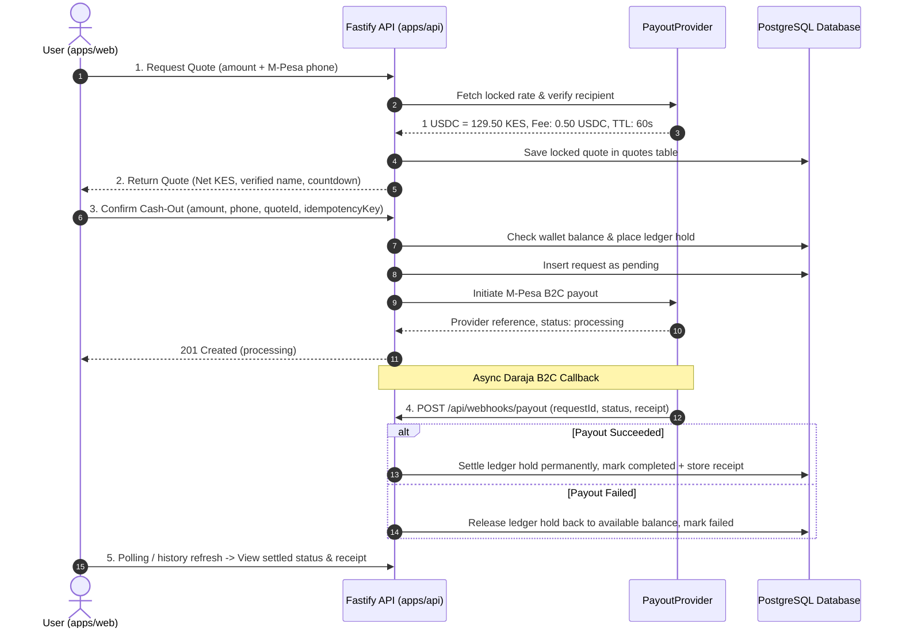

# Phundz cash-out request demo

A **production-architected** cash-out flow for Phundz, a dollar-backed wallet with local M-Pesa cash-out in Kenya.

> Designed to run both in **simulated mode** (`PAYOUT_MODE=mock`) for demonstrations/testing, and in **live mode** (`PAYOUT_MODE=live`) using the exact same state machine, ledger hold lifecycle, and webhook verification pathways.

## Architecture & Real-World Flow

The codebase is structured around a real-world financial off-ramp pipeline:



---

## What Was Added to Mirror Production

1. **Provider Abstraction (`PayoutProvider`)**:
   - Swapped seamlessly via `PAYOUT_MODE=mock|live`.
   - `MockProvider`: Computes exact KES conversions (without floating-point errors), simulates Safaricom M-Pesa registered account name lookups, and triggers an asynchronous B2C callback. Special test numbers (e.g. ending in `000`) simulate rejection/failure.
   - `LiveProvider`: Structured wrapper ready for Safaricom Daraja B2C (`/mpesa/b2c/v1/paymentrequest`) and live off-ramp liquidity partners.
2. **Double-Entry Ledger Holds**:
   - `wallets` table records `balance_usdc` (available) and `held_usdc` (displayed as "Processing cash-outs" in the wallet card).
   - Cash-out attempts exceeding available funds are rejected with `INSUFFICIENT_FUNDS`.
   - On request confirmation, funds are moved from available to held.
   - On webhook `completed`, the hold is debited permanently.
   - On webhook `failed`, the hold is released back to available balance.
3. **Live Quote Step & Expiry Countdown**:
   - `POST /api/quotes` locks the exchange rate (e.g. 1 USDC = 129.50 KES) and calculates exact net KES after fees.
   - The UI displays a live 60-second countdown with auto-refresh capability.
   - The server rejects submissions if a quote has expired (`EXPIRED_QUOTE`).
4. **Idempotency Key Protection**:
   - Submissions generate a client idempotency key (`idempotencyKey`). Duplicate submits return the existing request without double-holding funds.
5. **Asynchronous Webhook & Status Lifecycle**:
   - `POST /api/webhooks/payout` handles asynchronous provider callbacks.
   - Supported status transitions: `pending` → `processing` → `completed` (with M-Pesa receipt number) or `failed` (with failure reason).
6. **Dynamic Mode Awareness**:
   - `GET /api/config` serves the active configuration. The UI dynamically toggles between "SIMULATED MODE" and "LIVE PRODUCTION" badges.
7. **Real-Time Polling in History**:
   - The frontend automatically polls for updates every 2.5 seconds whenever a transaction is in `pending` or `processing` state.
8. **Bounded Dashboard History & Full Statement Modal**:
   - Prevents infinite scrolling on the main page by displaying only the **5 most recent** requests.
   - A prominent button ("View full statement & history ↗") opens a dedicated comprehensive modal dialog.
9. **Two-Sided Ledger Statement (Received vs. Sent)**:
   - Follows standard fintech accounting: breaks down account activity into **Received** (inflows / wallet deposits) and **Sent** (outflows / M-Pesa cash-outs).
   - Features KPI summary stats displaying total USDC received and total USDC sent for the active filtered period.
10. **Flexible Date Filtering & Single-Day Selector**:
    - Quick presets: `Today`, `Yesterday`, `Last 7 Days`, `Last 30 Days`, and `All Time`.
    - Custom single-day date picker (`input[type="date"]`) allows users to query transactions on any exact calendar day.
11. **Ergonomic Recipient Review Layout**:
    - Recipient name is positioned clearly beneath the E.164-formatted phone number, with the green `Verified` badge neatly aligned for improved readability.

---

## Layout

```
.
├── apps/
│   ├── api/                      Fastify API
│   │   ├── migrations/           Plain .sql files (001_create_cashout_requests, 002_add_wallet_quotes_and_lifecycle)
│   │   ├── src/
│   │   │   ├── app.ts            Builds the Fastify app (CORS, config, routes, providers)
│   │   │   ├── server.ts         Entry point (loads config, pool, listen)
│   │   │   ├── migrate.ts        `npm run migrate` runner
│   │   │   ├── config/env.ts     Env schema & validation
│   │   │   ├── providers/        PayoutProvider interface, MockProvider, LiveProvider
│   │   │   ├── routes/           Route wiring (/wallet, /quotes, /cashout-requests, /webhooks/payout)
│   │   │   ├── controllers/      HTTP in/out and zod validation
│   │   │   ├── services/         CashoutService (ledger holds, quotes, webhook dispatch, deposits)
│   │   │   ├── repositories/     WalletRepository, QuoteRepository, CashoutRepository
│   │   │   ├── db/               Query executor type, migration runner
│   │   │   └── errors/           AppError + centralized error handler
│   │   └── tests/                Integration tests (PostgreSQL integration + unit suites)
│   └── web/                      Next.js App Router frontend
│       ├── app/                  page.tsx, components/ (CashoutPanel, RequestHistory, HistoryModal), CSS modules
│       ├── lib/                  Typed API client, format helpers, useRequestHistory hook
│       └── tests/                React Testing Library + unit tests
├── packages/shared/              Shared Zod schemas, money math, quote/wallet/deposit types
├── scripts/dev-db.mts            `npm run db`: local PostgreSQL without Docker
├── docker/postgres-init/         Creates the phundz_test database
├── docker-compose.yml
└── .env.example
```

---

## Setup

Requirements: Node.js 20+ and npm 10+.

```sh
cp .env.example .env
npm install
```

Start PostgreSQL using **one** of these:

- **No Docker:** `npm run db` (local embedded PostgreSQL storing data in `.pgdata/`).
- **Docker:** `docker compose up -d` (starts Postgres 16 on port 5432).

Then run:

```sh
npm run migrate             # applies migrations to DATABASE_URL
npm run migrate:test        # applies migrations to TEST_DATABASE_URL
npm run dev                 # API on :4000, web on :3000
```

Open http://localhost:3000.

---

## Environment Variables

| Variable | Used by | Purpose | Default |
| --- | --- | --- | --- |
| `DATABASE_URL` | API, `migrate` | PostgreSQL connection string | **required** |
| `API_PORT` | API | Listen port | `4000` |
| `WEB_ORIGIN` | API | Allowed origin by CORS | `http://localhost:3000` |
| `PAYOUT_MODE` | API | `mock` (simulated sandbox) or `live` (production) | `mock` |
| `WEBHOOK_SECRET` | API | Secret for authenticating incoming payout webhooks | `whsec_...` |
| `TEST_DATABASE_URL` | tests, `migrate:test` | Separate DB for integration tests | skips integration if unset |
| `NEXT_PUBLIC_API_BASE_URL` | web | API base URL used by browser | `http://localhost:4000` |

---

## API Endpoints

| Method | Path | Description |
| --- | --- | --- |
| `GET` | `/health` | Health check (`{ "status": "ok" }`) |
| `GET` | `/api/config` | Exposes active mode, currency pair, and default rates |
| `GET` | `/api/wallet` | Returns available, held, and total USDC balance |
| `GET` | `/api/wallet/deposits` | Returns wallet funding history (inflows) |
| `POST` | `/api/quotes` | Creates a locked 60s quote with exchange rate and KES payout |
| `POST` | `/api/cashout-requests` | Places ledger hold, validates quote, and dispatches payout |
| `GET` | `/api/cashout-requests?limit=50` | Returns cash-out requests newest first |
| `POST` | `/api/webhooks/payout` | Webhook callback to settle (`completed`) or release (`failed`) hold |

---

## Tests

```sh
npm test            # 89 Vitest tests across all workspaces
npm run typecheck   # strict tsc --noEmit across all workspaces
```

- **Shared (`55 tests`)**: Amount parsing (BigInt cents, no float math), phone normalization to E.164, quote schema, cashout schema with idempotency, and query limits.
- **API (`22 tests`)**: Real PostgreSQL integration tests covering quotes, balance checks, holds, idempotency keys, webhooks, and boundary conditions.
- **Web (`12 tests`)**: RTL component tests for the form, quote review step, balance display, live refresh, format helpers, and error handling.

